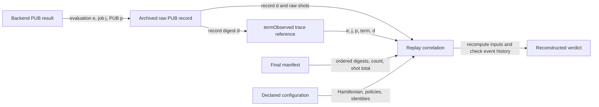

# Drafting guide for Section V-D: Runtime Verification

This guide follows the requested two opening paragraphs and six subsections. It is grounded in the supplied nine-page manuscript, the implemented QTL/Python interface, the archived Sampler campaigns, and the local benchmark report. Quoted passages are suggested manuscript wording; the surrounding text gives drafting instructions. Table and figure labels below are working labels to replace with LaTeX cross-references.

The section's central claim should be that the implementation preserves execution identity, makes monitor decisions effective at specified operations, and supports reconstruction of those decisions from linked evidence. Section V-B already includes per-iteration and cross-iteration trace checking, so “checking a concrete trace” alone does not identify the additional contribution.

Use “evaluation” for one monitored objective evaluation. Explain once that the implementation's event names retain `Iteration`, although an evaluation need not correspond to an accepted optimizer step. Keep the distinction throughout the results and cost discussion.

## Opening: two paragraphs, without a separate subsection

**Paragraph 1 — Connect to the established requirements.** Use the preceding layers as the starting point. A small qualification to “establish probabilistic behavior” keeps the wording consistent with V-C's Gaussian abstraction and empirical comparison:

> The preceding layers establish the control-flow requirements and numeric contracts of the shared VQE model and characterize its probabilistic behavior under the declared abstraction. Applying these requirements during execution requires an explicit correspondence between model-level operations and events produced by the controller, optimizer, and quantum backend. The runtime layer establishes and monitors this correspondence throughout a concrete run.

**Paragraph 2 — State the implementation problem and the four mechanisms.** Retain the concrete objects that have to remain associated:

> This correspondence must preserve which parameters, backend job, measurement results, and optimizer transition belong to each evaluation. The implementation must also ensure that a monitor decision refers to the operation currently awaiting execution and retain enough evidence to reconstruct that decision afterward. We address these requirements through structured instrumentation, past-time relational monitoring with DejaVu, synchronous authorization, and an explicitly linked evidence archive.

Proceed directly to the first subsection. These paragraphs already supply the section's purpose; another general explanation of runtime verification would repeat them.

## 1. Execution instrumentation and event representation

**Purpose:** Explain how concrete operations become observations with enough identity to instantiate the paper's requirements.

**Paragraph 1 — Start with the observation problem.** Begin:

> The first implementation challenge is to make model-level actions identifiable in the running software.

Explain that a semantic action such as measurement becomes a submission call, a returned job identifier, a result object, and individual term observations. Use one example: an energy can satisfy numerical bounds while being assembled from results associated with another evaluation or backend job. The failure concerns association even when the individual numbers look plausible.

End this paragraph with:

> Values must therefore be recorded together with the execution context in which they were obtained and used.

**Paragraph 2 — Introduce the event representation.** Begin:

> To preserve this context, each instrumented operation contributes a typed event to a single ordered stream.

Use one compact equation reflecting the actual separation between monitor arguments and rich payloads:

\[
\tau=\langle a_1,\ldots,a_m\rangle,
\qquad a_i=(i,n_i,\mathbf{x}_i,p_i).
\]

Define the sequence watermark \(i\), event name \(n_i\), identity tuple \(\mathbf{x}_i\), and payload \(p_i\). The identity tuple contains the relevant run ID, configuration digest, evaluation index/ID, parameter digest, submission ID, backend job ID, and term ID. Not every event has every identity: the external job ID becomes available only after submission. PUB indices and raw-evidence digests are carried in the term-observation payload. Monotonic timestamps and schema details can remain in the supplement.

Say explicitly that the configuration digest binds the resolved configuration, including the ordered Hamiltonian manifest. The configured manifest determines required terms; completeness is not inferred from whichever terms happen to appear in a trace.

**Paragraph 3 — Explain where the fields come from.** Begin:

> The instrumentation obtains these identities at the operations that create or consume them.

Describe assigning evaluation/submission IDs in the controller, hashing the actual parameter vector, recording the returned backend job ID, associating each result PUB with its declared term, and preserving the approved successor digest at optimizer commitment. Distinguish backend observations from checker-validated assertions such as `numericValid`.

**Implementation wording to preserve:** the journal appends events before the Python/DejaVu checks complete. Consequently, a record named `numericValid` is not, by its presence alone, proof of validity. Write “an accepted numeric certificate” or “a numeric assertion validated by Python before continuation.” Rejected events can remain in the diagnostic trace.

Insert **Table R1** immediately after this explanation:

| Instrumented operation | Event emitted | Identity/evidence preserved |
|---|---|---|
| Parameter binding | `parametersBound` | Evaluation ID, parameter vector and digest |
| Backend submission | `jobSubmitIntent`, then `jobSubmitted` | Evaluation, parameter digest, internal submission ID, returned job ID |
| Result retrieval | `termObserved` | Evaluation, submission/job, term, parameter digest; PUB index and evidence digest in payload |
| Optimizer commitment | `optimizerUpdated` | Evaluation and the exact approved successor vector/digest |

**Suggested caption:** “Instrumented operations and their identity-preserving runtime events. All events carry the applicable run and configuration context.”

Use Table II and Figure 2 of the manuscript to locate these operations in the shared execution model. Explain that the implementation records operation landmarks; it does not emit literal entry/exit pairs for every shared mode.

**Closing transition:**

> The resulting stream preserves both operation order and the identities needed to relate observations across an evaluation and its successors. These relationships form the input to the DejaVu encoding.

## 2. Past-time contract encoding with DejaVu

**Purpose:** Show how the requirements become relational obligations over the observed history.

**Paragraph 1 — Make the identity problem explicit.** Begin:

> Preserving event order is necessary, but the relevant prerequisite must also belong to the same execution context.

Explain that “some submission happened earlier” is too weak: the submission must match the observed result's run, configuration, evaluation, submission ID, job, and parameter digest. Introduce quantified identities and past-time predicates as the mechanism that expresses this match.

**Paragraph 2 — Define the Python–DejaVu division.** Begin:

> We express these obligations through two cooperating checkers.

Explain that Python reads full payloads, checks values and immediate execution state, and validates numeric assertions. DejaVu receives compact event names and identity arguments and checks temporal relationships. Refer to V-B, Table III, and Equations (3)–(4) for arithmetic contracts rather than re-deriving energy aggregation and bounds.

Add one precise sentence:

> Reusing the numeric contracts does not establish that the Python instrumentation, optimizer, or monitor bridge inherits the Dafny proofs; their correspondence and implementation behavior are separate verification obligations.

Insert **Table R2** to organize the encoding:

| Scope | Runtime relationship | Event identities involved |
|---|---|---|
| Intra-evaluation | A term observation matches a previously authorized and recorded submission | Run/configuration, evaluation, submission, job, term, parameter digest |
| Inter-evaluation | A successor binding matches the preceding committed candidate | Previous/current evaluation, committed parameter digest |
| Whole run | Activity belongs to the active lifecycle and respects its terminal boundary | Run/configuration, activity, terminal and close events |

**Suggested caption:** “Scopes of the runtime encoding and the identities required to instantiate their obligations.”

**Paragraph 3 — Present three implemented representative formulas.** Introduce them with:

> The following properties illustrate submission matching, identity uniqueness, and checkpoint association.

Use the following mathematical rendering of the implemented QTL. All variables outside an explicit existential quantifier are universally quantified over the monitor domain. Here \(P\) is past-or-present occurrence, and \(@P\) excludes the current event. Distinct event types make the first and third prerequisites earlier events in this stream. Let \(r,c,k,e,s,j,u,h\) denote run, configuration, evaluation index, evaluation ID, submission, job, term, and parameter digest.

**Matching submission — `intra_termAfterSubmission`:**

\[
\operatorname{termObserved}(r,c,k,e,s,j,u,h)
\rightarrow P\,\operatorname{jobSubmitted}(r,c,k,e,s,j,h).
\]

Explain that the same identity variables appear on both sides. Authorization of the submission itself is enforced by companion intent/binding properties; this formula establishes the observation-to-submission relationship.

**Fresh backend job identity — `inter_backendJobIdentityUnique`:**

\[
\operatorname{jobSubmitted}(r,c,k,e,s,j,h)
\rightarrow
\neg\exists k',e',s',h'.\;@P\,
\operatorname{jobSubmitted}(r,c,k',e',s',j,h').
\]

Explain that changing the evaluation or internal submission ID cannot make a reused external job ID fresh within the same run/configuration.

**Checkpoint association — `inter_previousEnergyIsLastCheckpoint`:**

\begin{aligned}
&\operatorname{nextConvergenceChecked}(r,c,k,e,h_E,h_\theta,e_p,h_{E_p},b)\\
&\quad\rightarrow\exists k_p,h_{\theta_p},b_p,h_{\mathrm{next}}.\;
P\,\operatorname{iterationClosed}
(r,c,k_p,e_p,h_{E_p},h_{\theta_p},b_p,h_{\mathrm{next}}).
\end{aligned}
\]

Define \(h_E\) as an energy digest, \(e_p\) as the referenced predecessor, and \(b\) as the declared convergence result. Explain that the previous evaluation and energy must occur together in a recorded closed checkpoint.

**Important qualification:** despite its property name, this last QTL implication establishes the existence of a matching prior checkpoint. Python's `inter_previous_energy_continuity` additionally requires the immediately preceding checkpoint. Keep the claim at the level of the cooperating checkers; do not attribute immediate-predecessor selection to this formula alone.

**Paragraph 4 — Explain incremental verdicts.** Begin:

> As each event arrives, DejaVu updates the monitored relations and reports whether the extended prefix violates any property.

Mention property identifiers in rejection reports. Distinguish acceptance of the current prefix from a complete-run PASS. Final reporting requires the closing/lifecycle evidence and all applicable checks; a truncated trace or unavailable monitor is inconclusive when no stronger failure is established. Do not describe a passing finite prefix as proof of eventual termination.

**Closing transition:**

> The monitor thus supplies a verdict for a specific event prefix. Making that verdict effective at the intended operation requires synchronization with the controller.

## 3. Synchronous monitoring and optimizer commitment

**Purpose:** Locate the decision and mutation boundaries precisely.

**Paragraph 1 — Introduce the two timing hazards.** Begin:

> A correct monitor verdict can arrive too late if the controller advances before the corresponding event has been processed.

Explain delayed/asynchronous monitoring, then the optimizer-specific problem: a callback can expose a candidate after hidden optimizer state has already changed. The integration therefore needs both a matching event acknowledgement and an explicit pre-mutation interface.

**Paragraph 2 — Explain the acknowledgement protocol once.** Begin:

> To align verification with execution, the controller waits for an acknowledgement carrying the submitted event's sequence watermark.

Describe the actual order: append the event to the journal, pass its full content to Python, submit compact arguments to DejaVu, and require Python acceptance plus a successful matching acknowledgement before continuation. The bridge rejects malformed event names/arities and nonconsecutive watermarks. Mention submission and objective release as other guarded operations, with V-A supplying the underlying prerequisites.

The acknowledgement carries sequence, verdict, and violation identifiers when applicable. It does not independently carry or sign the candidate digest. Candidate association follows from the controller retaining the exact pending event and waiting for its sequence.

**Paragraph 3 — Explain ask/tell at the mutation boundary.** Begin:

> For optimizer updates, this synchronization is coupled to a two-phase ask/tell interface.

Describe `preview_update(theta, energy)` producing a candidate and an opaque token without changing optimizer search state. The controller submits `optimizerUpdateIntent` with the exact candidate and digest. Only after successful authorization does it call `commit_update(token, authorized_theta=candidate)`. The optimizer checks token ownership, generation, reuse, and candidate agreement before mutation. The controller then records `optimizerUpdated`, closes the evaluation, and starts/binds the successor using the same digest.

Do not call the token a verifier-issued authorization token: it is generated by the optimizer and binds a proposed transition. The controller combines it with the acknowledged authorization of the exact candidate. The protocol is not a distributed atomic transaction and does not promise rollback after a subsequent journaling failure.

Insert **Figure R1(a)** here. Keep controller, optimizer, and verifier lanes; the verifier lane combines the Python session/checker and DejaVu protocol for readability.

```mermaid
sequenceDiagram
    participant C as Controller
    participant O as Optimizer
    participant V as Verifier (Python + DejaVu)
    C->>O: preview_update(theta_k, E_k)
    O-->>C: candidate theta_next, token T (no mutation)
    C->>V: optimizerUpdateIntent(seq=q, e_k, h_next), candidate payload
    V->>V: Journal, Python validation, DejaVu prefix check
    V-->>C: ACK(q, PASS)
    Note over C,V: Match q to the pending event containing h_next
    C->>O: commit_update(T, authorized_theta=theta_next)
    rect rgb(255, 235, 215)
    Note over O: OPTIMIZER MUTATION POINT: validated token and exact candidate
    O->>O: Apply proposed transition once
    end
    O-->>C: Commit returns
    C->>V: optimizerUpdated(seq=q+2, e_k, h_next)
    V-->>C: ACK(q+2, PASS)
    C->>V: iterationClosed; nextIterationStarted(e_next, e_k, h_next)
    V-->>C: Matching acknowledgements
    C->>V: parametersBound(e_next, h_next)
    V-->>C: Matching acknowledgement
```

The `q+2` spacing reflects the intervening `activity` event in the implemented successful path. State in the caption that activity witnesses and their acknowledgements are omitted visually. Candidate digests cross into the verifier in event arguments; the candidate vector and token cross into the optimizer at commitment.

**Suggested caption:** “Synchronous authorization of an exact optimizer candidate. The controller matches each acknowledgement to its pending event before advancing. Shading marks the optimizer mutation boundary; activity witnesses and routine acknowledgements are omitted.”

For the typeset version, a small rejection branch may end at “withhold commit/abort”; keep the successful path dominant.

**Closing qualification and transition — two sentences:**

> Rejection or a missing matching acknowledgement prevents the pending guarded operation from proceeding, provided that the controller uses the instrumented interface. The recorded authorization and commitment events must also remain associated with the measurement evidence that justified them.

## 4. Evidence association and replay

**Purpose:** Explain which preserved backend record supports each observed event and how replay checks that association.

**Paragraph 1 — State the evidence gap.** Begin:

> An ordered lifecycle trace does not, by itself, identify all raw data supporting a recorded measurement.

Explain that `termObserved` contains compact values and identities, while the complete Sampler result is larger. Define a PUB once as a primitive unified bloc, the unit of input/result association used by the Sampler API. The design preserves one complete raw record per PUB in an accompanying JSONL sidecar.

**Paragraph 2 — Describe trace, sidecar, and manifest.** Begin:

> We therefore link each term observation to a preserved PUB record through both execution identities and a content digest.

Group the record contents into three readable categories: raw observations (ordered bitstrings, packed BitArray, complete count dictionary, observed shot count); association fields (evaluation, submission/job, PUB index, term, parameter identity); provenance (circuit digests, layout, timestamps, and returned metadata/options). The trace references the record's digest. The final sidecar manifest records the ordered record digests, record count, and total observed shots. Replay also compares the archive with the trace and configured Hamiltonian so completeness is checked against an external declared expectation.

Clarify once that hashes support integrity/linkage relative to the retained evidence; they are not producer signatures.

Insert **Figure R1(b)** with these associations:



**Suggested caption:** “Evidence association for replay. A trace observation and its independently supplied raw archive record must agree on evaluation, job, PUB/term assignment, and digest. The manifest and declared configuration support completeness checks.”

Panel (a) can sit above panel (b) in a two-column figure. Refer to (a) in Subsection 3 and (b) here. Use arrows to denote association, not a backend signing the record or a cryptographic proof of physical execution.

**Paragraph 3 — Explain replay immediately after the diagram.** Begin:

> During replay, the checker reloads the declared configuration, event stream, and explicitly supplied evidence sidecar.

State the operations in order: validate record/manifest hashes and ordering; correlate each observation with the unique expected PUB record; check job, parameter, circuit, and term/PUB associations; reconstruct counts/parity expectations from the raw data; recheck numeric payloads and temporal history; reconstruct the report. For the parity explanation, one sentence suffices: odd parity over the measured non-identity positions determines the negative-eigenvalue count used by the numeric checker. Refer to V-B for aggregation and bounds.

Explain why the sidecar is an independent input: the trace cannot choose the archive against which its own claims are checked. This is independent selection of evidence and a separate replay execution, not independently implemented checker algorithms.

**Paragraph 4 — Interpret agreement.** Begin:

> Agreement between online verification and replay shows that the verdict can be reproduced from the retained execution evidence.

Qualify that shared checker code remains a common source of error and backend observations remain trusted. Replay does not re-execute quantum jobs or recover physical truth from a self-consistent archive.

**Closing transition:**

> This evidence path makes the runtime mechanism testable through completed executions, controlled faults, and mismatches between the trace and its archive.

## 5. Implementation validation and H₂ execution results

**Purpose:** Present evidence that the implemented observation, enforcement, and replay mechanisms operate on the declared executions.

**Paragraph 1 — Establish the specific campaign.** Begin:

> We evaluated the runtime mechanism using the previously introduced two-qubit H₂ family, with a count-backed Sampler integration on a simulator and IBM hardware.

Name `StatevectorSampler` for the simulator and IBM Runtime `SamplerV2` on `ibm_marrakesh` for hardware. State that one job per objective evaluation contains four independently sampled term PUBs. Introduce raw evidence, explicit ask/tell pattern search, and the 50-evaluation bound. These are individual execution demonstrations, not the 400-run campaign in V-C.

Insert **Table R3** only for settings needed to interpret this experiment:

| Setting | Runtime campaign |
|---|---|
| Measurement design | Four separate term PUBs (`YZ`, `ZI`, `ZZ`, `XX`) per job/evaluation |
| Shots | 1,024 per PUB; 4,096 per evaluation |
| Optimizer | Explicit ask/tell pattern search; same four-parameter initialization, seed 7 |
| Convergence policy | Tolerance 0.005; minimum 10 evaluations; patience 3 consecutive qualifying deltas |
| Bound | 50 evaluations; 200 PUBs; 204,800 shots per complete bounded run |
| Observation policy | Raw counts/bitstrings required; direct raw Sampler evidence |

**Suggested caption:** “Runtime-specific configuration for the simulator and hardware executions.”

Follow the table with the distinction the reader needs:

> This campaign uses separate term PUBs, an explicit ask/tell pattern-search policy, and tolerance 0.005. Section V-C uses commuting measurement groups, a current/minus/plus candidate-selection model, and tolerance 0.02; the runtime executions therefore assess the implemented monitoring protocol and do not directly validate that particular Storm configuration.

Also distinguish V-B's existing IBM Estimator campaign. The supplied manuscript reports 25 executed evaluations, 4,096 shots per term, and tolerance 0.01 there. A short sentence identifying it as a separate campaign prevents apparently conflicting H₂ results. Its configured cap is 60, whereas the runtime campaign's cap is 50.

**Paragraph 2 — Lead with verification outcomes.** Begin:

> Both executions completed the declared evaluation bound and passed online verification and replay at all three monitoring scopes.

Insert **Table R4**, populated from the archived traces/reports:

| Verification measure | StatevectorSampler | IBM SamplerV2 |
|---|---:|---:|
| Objective evaluations | 50 | 50 |
| Jobs / PUB records | 50 / 200 | 50 / 200 |
| Observed samples/shots | 204,800 simulated samples | 204,800 hardware shots |
| Intent–commit–successor chains | 49 | 49 |
| Trace events | 2,103 | 2,103 |
| Online / replay | PASS / PASS | PASS / PASS |
| Intra / inter / whole-run scopes | PASS / PASS / PASS | PASS / PASS / PASS |
| Terminal reason | `max_iterations` | `max_iterations` |

**Suggested caption:** “Runtime-verification outcomes for the two count-backed H₂ executions. Shot counts are checked against returned evidence. The separate hardware preflight is excluded.”

Explain the 49 transitions: the final evaluation reaches the bound and does not generate another successor. Explain that truthful termination at the bound is a passing lifecycle outcome; neither run satisfied the declared convergence policy. Keep energy quality separate from this finding.

**Paragraph 3 — Provide one short execution witness.** Begin:

> A short excerpt from the hardware trace shows how one returned result remains linked to the subsequent optimizer transition.

Use the actual evaluation-0 association below as a compact listing or boxed trace, not another full results table. Define `h0 = 1d0b2ef6…e609`, `h1 = a2a5a327…8844`, and `d0 = dc9f5db5…0653`. Abbreviations are display-only; full digests remain in the archive.

```text
seq 19  jobSubmitted       eval0, submission0, job=dafntbdnj4cs73agk91g, theta=h0
seq 21  termObserved       eval0, same job, t0/YZ, PUB=0, raw=d0, shots=1024
        ...               t1–t3 observations and measurement seal
seq 31  numericValid       eval0, theta=h0, accepted energy≈0.1916484375
        ...               convergence check, iteration pass, objective release
seq 41  optimizerUpdateIntent  eval0, proposed successor=h1
        [protocol]        matching ACK(41, PASS) required before commit
seq 43  optimizerUpdated       eval0, committed successor=h1
seq 45  iterationClosed        eval0, next_theta=h1
seq 47  nextIterationStarted   eval1, predecessor=eval0, theta=h1
seq 49  parametersBound        eval1, theta=h1
```

**Suggested caption:** “Selected hardware trace events linking a returned PUB to the next authorized parameter binding. Ellipses omit intervening events. The acknowledgement annotation describes the enforced protocol; acknowledgements are not separate rows in the JSONL trace.”

Explain the witness in two sentences: the raw record belongs to the recorded job and PUB; the same successor digest crosses authorization, commitment, closure, and binding. Do not expand the energy calculation.

**Paragraph 4 — Present selected faults and identify the enforcing component.** Begin:

> We then examined defects that preserve plausible numeric values while breaking execution identity or the authorization protocol.

Use **Table R5**. Separate a malformed event sequence, an actual attempted optimizer mutation, and a provenance inconsistency when describing the tests.

| Runtime defect | Concrete change or attempt | Detection/evidence to report |
|---|---|---|
| Reused job identity | Associate a later evaluation with an earlier external job ID | Job-identity uniqueness checks; existing replay regression `test_reused_backend_job_identity_is_rejected_run_wide` |
| Mismatched successor | Bind parameters different from the committed candidate | `inter_theta_continuity`; existing online and Sampler contract regressions |
| Duplicate commitment | Replay `optimizerUpdated` twice; separately attempt token reuse | Duplicate event rejected by Python `inter_update_applied_once` and DejaVu `inter_updateAppliedOnce`; token-reuse regression checks rejection before another mutation |
| Stale checkpoint reference | At evaluation 2, reference the valid evaluation-0 checkpoint instead of evaluation 1 | Python `inter_previous_energy_continuity`; a targeted local replay rejects the mutation even though the older checkpoint exists |
| Inconsistent evidence provenance | Sidecar circuit digest differs from run provenance | Archived preflight replay: FAIL under `run_execution_options` |

**Suggested caption:** “Selected runtime-specific faults and their detection mechanisms. Numeric fault classes are reported separately in Table V.”

The stale-checkpoint and duplicate-event results were checked during preparation of this guide against the three-evaluation deterministic archive, with an unchanged PASS control. They are local replay checks, not injected IBM faults. The other regression rows identify implemented tests; the campaign report records 129 passing tests before hardware submission, but that historical suite count is not a count of these fault classes. Retain dedicated mutation reports if the final manuscript reports a mutation-detection rate.

**Paragraph 5 — Describe the preflight incident.** Begin:

> The hardware preflight also exposed an evidence-capture defect that was not apparent from the measurement values.

State the exact disagreement: the sidecar's parameterized-circuit QPY hash differed from the hash recorded in run provenance. Replay rejected `run_execution_options` at sequence 27. Investigation in the campaign report attributes the mismatch to separately serializing the same parameterized circuit for the two records. The correction captured each QPY digest once and reused it across the evidence paths. The original preflight was retained; the corrected primary run subsequently passed replay.

Do not label the preflight an online PASS: its one-evaluation online report was INCONCLUSIVE for inter-evaluation evidence, and its replay report was FAIL for provenance. Its four PUBs and 4,096 shots are separate from the primary run's totals.

**Closing interpretation and transition:**

> These executions demonstrate that the implemented protocol can preserve measurement and optimizer identities through complete bounded runs, while the selected faults exercise its rejection paths. The remaining practical question is the cost of maintaining these checks as the event history grows.

An energy-trajectory plot can be supplementary. The main evidence here is the verified chain of operations and evidence associations.

## 6. Monitoring cost and implementation limits

**Purpose:** Quantify the costs introduced by synchronous waiting and retained identity relationships, then state the supported bound.

**Paragraph 1 — Connect cost to the mechanism.** Begin:

> Synchronous authorization adds an acknowledgement wait to each instrumented event, while relational monitoring retains information about previously observed identities.

Identify startup, per-event acknowledgement, retained monitor memory, and evidence persistence/storage as different costs. The available local benchmark measures the synthetic monitoring path; do not present it as a complete measurement of raw-sidecar storage overhead or cloud VQE wall-time overhead.

**Paragraph 2 — State the design precisely.** Begin:

> We measured the local monitoring path against an uninstrumented synthetic loop and a Python-only shadow-monitor condition.

State five warm-ups and 30 measured repetitions **per condition for the primary three-evaluation comparison**. Distinguish the scaling sweep: it uses **one measured run per declared evaluation count**, with gate-level latency samples and memory sampling. Hardware queue/execution time is excluded. The shadow monitor is a cost comparator and cannot establish DejaVu assurance.

Useful compact figures for the prose: primary end-to-end medians were 358.260 ms for DejaVu, 7.185 ms for the Python shadow, and 0.040 ms for the tiny uninstrumented loop; DejaVu startup median was 228.539 ms. This explains why a large relative percentage against that baseline would be misleading. Put detailed procedure, sampling definitions, and environment in Section VIII.

Insert **Figure R2**, two aligned panels:

- **Panel (a):** evaluation count on the horizontal axis; p95 acknowledgement round-trip latency in milliseconds on the vertical axis. Plot separate series for all events and `nextConvergenceChecked`. A logarithmic vertical axis is reasonable for the full range; label it explicitly if used.
- **Panel (b):** evaluation count on the horizontal axis; JVM peak resident memory in MiB on the vertical axis. Do not silently substitute combined Python+JVM memory for JVM-only memory.

Mark a vertical line at 50 evaluations in both panels, labelled “H₂ runtime campaign bound.” Use point markers to identify measured sizes and disclose that these are single-run scaling observations. Do not add confidence intervals that the scaling data do not support. Gate p95 is a within-run event-latency statistic, not a confidence bound across repeated scaling runs.

Selected plot values, for author reference rather than an additional manuscript table:

| Evaluations | All-event p95 (ms) | `nextConvergenceChecked` p95 (ms) | JVM peak RSS (MiB) |
|---:|---:|---:|---:|
| 10 | 1.214 | 1.332 | 219.03 |
| 25 | 1.063 | 1.237 | 273.66 |
| 50 | 0.984 | 1.305 | 439.80 |
| 60 | 0.929 | 1.669 | 481.05 |
| 100 | 0.970 | 1.532 | 635.36 |
| 125 | 1.438 | 2.307 | 718.81 |
| 150 | 3.722 | 4.373 | 839.92 |
| 175 | 7.742 | 7.606 | 847.94 |
| 200 | 16.362 | 16.222 | 941.80 |

**Suggested caption:** “Local scaling of synchronous DejaVu monitoring: (a) p95 event-acknowledgement latency and (b) JVM peak resident memory. Each size is one measured synthetic run; hardware queue and execution time are excluded. The vertical line marks the 50-evaluation campaign bound.”

**Paragraph 3 — Interpret the bound and the convergence relation.** Begin:

> At the 50-evaluation bound, the observed all-event p95 acknowledgement latency was 0.984 ms, while `nextConvergenceChecked` reached 1.305 ms and JVM peak resident memory was 439.80 MiB.

Then compare with 200 evaluations: 16.362 ms, 16.222 ms, and 941.80 MiB, respectively. Explain that memory grows across the sweep and latency rises materially beyond approximately 125 evaluations in these measurements. Describe `nextConvergenceChecked` as retaining the relationship between current evaluation/energy/parameters and a referenced previous checkpoint; immediate-predecessor validity also relies on Python, as explained in Subsection 2.

Use careful causal language: these are measurements of the full monitor and an event-specific latency series. They do not, without an ablation, prove that this single relation causes all memory or latency growth. The measurements justify retaining the relation for the declared 50-evaluation profile while disclosing its practical history bound. Avoid “constant overhead” or an unbounded scalability claim.

**Paragraph 4 — Identify the redesign as future work.** Begin:

> For longer histories, a proposed redesign would replace the wide temporal checkpoint tuple with a compact checkpoint certificate.

Explain that the certificate would bind the current and predecessor identities, while Python retains exact energy-delta, parameter, and patience checks and DejaVu checks compact checkpoint relationships. Require differential fault tests and a rebuilt-monitor scaling study before claiming preserved detection behavior or improved scalability. This redesign has not been implemented or measured; do not place it on the achieved-results side of the argument.

**Paragraph 5 — Close with runtime scope and hand off to Section VI.** Begin:

> The current implementation assumes sequential evaluations, faithful use of the instrumented interfaces, and an available monitor and evidence journal.

Mention that the declared profile has one job per evaluation; concurrent evaluations, retries, split-job measurement, and recovery require an extended protocol. Keep broader trust/generalization discussion in Section X.

End the section with:

> Within this scope, the runtime layer connects the paper's requirements to authorized operations and replayable execution evidence. Section VI considers how this execution-level evidence composes with the guarantees established by the other layers.

## Editorial map and integration notes

The main-body progression should remain:

**Execution observations → relational specification → synchronized enforcement → replayable evidence → implementation results → cost and limits.**

Use descriptive transitions that carry an object forward: “this context,” “these relationships,” “that verdict,” “the supporting evidence,” and “the growing event history.” This will make the argument read as a connected explanation rather than six independent descriptions. Prefer those links over repeatedly starting paragraphs with “Furthermore” or “Moreover.”

| Location | Main-body artifact | Function |
|---|---|---|
| Opening | Two paragraphs | State correspondence problem and mechanisms |
| Subsection 1 | One event equation; Table R1 | Define observable interface |
| Subsection 2 | Table R2; three formulas | Explain relational encoding |
| Subsections 3–4 | Figure R1(a)–(b) | Show mutation timing and evidence association |
| Subsection 5 | Tables R3–R5; one trace listing | Establish configuration, outcomes, and selected rejection evidence |
| Subsection 6 | Two-panel Figure R2 | Show latency/memory cost and the experimental bound |

Keep full event schemas, bridge serialization, all properties, complete raw-count examples, full hashes, job inventories, version manifests, commands, and detailed benchmark procedures in supplementary material or Section VIII. Cross-reference V-A for ordering, V-B for arithmetic and numeric faults, V-C for the probabilistic configuration, VI for composition, and X for broader assumptions.

Two manuscript integration points deserve attention. Figure 2 currently labels runtime coverage “Every event entry / exit”; the implemented landmark interface should be reflected in that wording or qualified in V-D. Table I gives runtime a probabilistic-reliability mark, but these individual runs do not establish a convergence probability; any such connection needs an explicit composition argument in Section VI.

## Source map for the authors

These are drafting sources, not additional main-body content.

- [Supplied manuscript](</Users/rome/Downloads/Formal_Verification_in_Hybrid_Quantum_Classical_Computing_Systems (1).pdf>): V-A and Table II for shared modes; V-B, Tables III–V and Figure 6 for existing numeric trace checking and its separate Estimator campaign; V-C, Figure 8 and Table VI for the distinct probabilistic campaign.
- [Implemented QTL properties](</Users/rome/Desktop/VQE Runtime Verification - DejaVu/specs/vqe_runtime.qtl>) and [design rationale](</Users/rome/Desktop/VQE Runtime Verification - DejaVu/docs/DESIGN.md>): relational obligations and finite-trace semantics.
- [Session interface](</Users/rome/Desktop/VQE Runtime Verification - DejaVu/src/vqe_runtime/session.py>), [DejaVu bridge adapter](</Users/rome/Desktop/VQE Runtime Verification - DejaVu/src/vqe_runtime/dejavu.py>), and [optimizer](</Users/rome/Desktop/VQE Runtime Verification - DejaVu/src/vqe_runtime/optimizer.py>): acknowledgement and commitment protocol.
- [Raw archive implementation](</Users/rome/Desktop/VQE Runtime Verification - DejaVu/src/vqe_runtime/evidence.py>) and [replay correlation](</Users/rome/Desktop/VQE Runtime Verification - DejaVu/src/vqe_runtime/evidence_replay.py>): sidecar/manifest association.
- [Campaign technical report](</Users/rome/Desktop/VQE Runtime Verification - DejaVu/artifacts/reports/H2_SAMPLER_TECHNICAL_REPORT_20260907.md>) and [campaign summary](</Users/rome/Desktop/VQE Runtime Verification - DejaVu/artifacts/results/h2_sampler_comparison_20260907/campaign_summary.json>): experiment results and historical validation.
- [Hardware trace](</Users/rome/Desktop/VQE Runtime Verification - DejaVu/artifacts/traces/h2_ibm_marrakesh_sampler_20260907.jsonl>), [online report](</Users/rome/Desktop/VQE Runtime Verification - DejaVu/artifacts/reports/h2_ibm_marrakesh_sampler_20260907_online.json>), and [replay report](</Users/rome/Desktop/VQE Runtime Verification - DejaVu/artifacts/reports/h2_ibm_marrakesh_sampler_20260907_replay.json>): Table R4 and the trace witness.
- [Preflight online report](</Users/rome/Desktop/VQE Runtime Verification - DejaVu/artifacts/reports/h2_ibm_marrakesh_sampler_preflight_20260907_online.json>) and [preflight replay report](</Users/rome/Desktop/VQE Runtime Verification - DejaVu/artifacts/reports/h2_ibm_marrakesh_sampler_preflight_20260907_replay.json>): distinguish one-evaluation inconclusiveness from the provenance failure.
- [Targeted local replay check summary](</Users/rome/Desktop/VQE Runtime Verification - DejaVu/tmp/runtime-drafting-validation/summary.json>): unchanged control, stale checkpoint, and duplicate commitment checks performed while preparing this guide; not part of the historical IBM campaign.
- [Benchmark report](</Users/rome/Desktop/VQE Runtime Verification - DejaVu/artifacts/benchmarks/BENCHMARK_REPORT.md>) and [raw benchmark directory](</Users/rome/Desktop/VQE Runtime Verification - DejaVu/artifacts/benchmarks/h2_monitor_baseline_20260906>): Figure R2 and benchmark-design qualifications.
